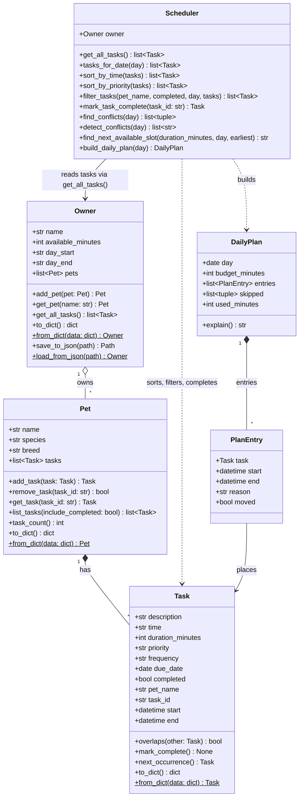

# 🐾 PawPal+

PawPal+ is a smart pet care planner built with Python and Streamlit. It helps a busy owner keep track of every pet's feedings, walks, medications, grooming, and appointments, then turns that list into a realistic daily plan: sorted by time, checked for double bookings, filled by priority within the time the owner actually has, and explained in plain language.

The project follows a **CLI first** workflow: all logic lives in `pawpal_system.py`, is verified with a terminal demo (`main.py`) and a pytest suite, and only then is wired into the Streamlit UI (`app.py`).

## ✨ Features

- **Multi pet management**: one owner, any number of pets, each with its own task list.
- **Sorting by time**: every pet's tasks merged into one chronological schedule (`Scheduler.sort_by_time()`).
- **Filtering**: by pet, completion status, and date, in any combination (`Scheduler.filter_tasks()`).
- **Conflict warnings**: detects overlapping time windows (not just identical start times) across the same pet or different pets, and suggests the next free slot instead of crashing (`Scheduler.detect_conflicts()`).
- **Daily and weekly recurrence**: completing a repeating task automatically creates the next one using `timedelta` (`Scheduler.mark_task_complete()`).
- **Priority based daily plan**: fills the owner's daily time budget highest priority first, moves lower priority clashes to the next free slot (time blocking), and explains every decision (`Scheduler.build_daily_plan()`).
- **Next available slot**: finds the first gap in the owner's day that fits a given duration (`Scheduler.find_next_available_slot()`).
- **Saves between runs**: pets and tasks persist to `data.json` (`Owner.save_to_json()` / `Owner.load_from_json()`).
- **Readable output**: emoji task icons, color coded priority badges, and `tabulate` tables in the CLI.

## 🏗️ System Design

| Class | Responsibility |
|-------|----------------|
| `Task` | One care activity: description, `"HH:MM"` time, duration, priority, frequency, due date, completion status. Knows its own time window (`start`, `end`, `overlaps()`) and how to produce its next occurrence. |
| `Pet` | Identifying info (name, species, breed) and its list of tasks: `add_task()`, `remove_task()`, `get_task()`, `list_tasks()`, `task_count()`. |
| `Owner` | The person: their pets, daily time budget (`available_minutes`), and the hours they're available (`day_start` to `day_end`). `get_all_tasks()` returns every pet's tasks together. Handles JSON save/load. |
| `Scheduler` | The "brain." Reads tasks **only** through `Owner.get_all_tasks()`, so every algorithm works across all pets. |
| `DailyPlan` / `PlanEntry` | The result of `build_daily_plan()`: which tasks fit, when, and why. Planning never edits the original tasks. |

Final UML (source: [`diagrams/uml_final.mmd`](diagrams/uml_final.mmd), also saved as `diagrams/uml.mmd`; the Phase 1 draft is [`diagrams/uml_draft.mmd`](diagrams/uml_draft.mmd)):



## 🚀 Getting Started

```bash
python -m venv .venv
source .venv/bin/activate        # Windows PowerShell: .\.venv\Scripts\Activate.ps1
pip install -r requirements.txt
```

| What | Command |
|------|---------|
| Run the Streamlit app | `streamlit run app.py` |
| Run the CLI demo | `python main.py` |
| Run the tests | `python -m pytest` |

## 🧱 Implementation Summary

All backend logic lives in `pawpal_system.py`. `Task`, `Pet`, and `Owner` are dataclasses because they're mostly data; `Scheduler` is a regular class because it's all behavior. The flow is:

1. `Pet.add_task()` attaches a `Task` and stamps it with the pet's name, so a task can still say who it belongs to after the Scheduler flattens all pets together.
2. `Owner.get_all_tasks()` merges every pet's tasks into one list.
3. `Scheduler(owner)` reads from that one method and does all the sorting, filtering, conflict checks, recurrence, and planning.
4. `Task.__post_init__` validates input and normalizes times like `"9:00"` to `"09:00"`, which is what lets sorting stay a one line `lambda` key.

`main.py` builds an owner with two pets and eight tasks (deliberately added out of order, with one double booking) and prints every feature. `app.py` keeps the `Owner` in `st.session_state` and calls the same methods.

## 🖥️ Sample Output

Output of `python main.py` (run on 10/18/26):

```
🐾 PawPal+ demo for Jordan: 2 pets, 8 tasks, 150 min available (07:00 to 21:00)

📅 Today's Schedule: Scheduler.sort_by_time() across all pets
╭─────────────┬──────────────────────────┬─────────┬───────┬────────────┬───────────┬──────────╮
│ When        │ Task                     │ Pet     │   Min │ Priority   │ Repeats   │ Status   │
├─────────────┼──────────────────────────┼─────────┼───────┼────────────┼───────────┼──────────┤
│ 10/18 07:30 │ 🦮 Morning walk          │ Biscuit │    30 │ 🔴 high    │ daily     │ ⬜ todo  │
│ 10/18 07:30 │ 🧹 Litter box cleanup    │ Mochi   │    10 │ 🟡 medium  │ daily     │ ⬜ todo  │
│ 10/18 08:15 │ 🍖 Breakfast             │ Biscuit │    10 │ 🔴 high    │ daily     │ ⬜ todo  │
│ 10/18 08:30 │ 🍖 Breakfast             │ Mochi   │    10 │ 🔴 high    │ daily     │ ⬜ todo  │
│ 10/18 09:00 │ 💊 Flea medication       │ Mochi   │     5 │ 🔴 high    │ weekly    │ ⬜ todo  │
│ 10/18 15:00 │ 🩺 Vet checkup           │ Biscuit │    60 │ 🔴 high    │ once      │ ⬜ todo  │
│ 10/18 17:00 │ 🧼 Grooming and brushing │ Biscuit │    45 │ 🟢 low     │ weekly    │ ⬜ todo  │
│ 10/18 18:00 │ 🎾 Evening play          │ Mochi   │    20 │ 🟢 low     │ daily     │ ⬜ todo  │
╰─────────────┴──────────────────────────┴─────────┴───────┴────────────┴───────────┴──────────╯

🔎 Filter: Scheduler.filter_tasks(pet_name='Mochi')
╭─────────────┬───────────────────────┬───────┬───────┬────────────┬───────────┬──────────╮
│ When        │ Task                  │ Pet   │   Min │ Priority   │ Repeats   │ Status   │
├─────────────┼───────────────────────┼───────┼───────┼────────────┼───────────┼──────────┤
│ 10/18 07:30 │ 🧹 Litter box cleanup │ Mochi │    10 │ 🟡 medium  │ daily     │ ⬜ todo  │
│ 10/18 08:30 │ 🍖 Breakfast          │ Mochi │    10 │ 🔴 high    │ daily     │ ⬜ todo  │
│ 10/18 09:00 │ 💊 Flea medication    │ Mochi │     5 │ 🔴 high    │ weekly    │ ⬜ todo  │
│ 10/18 18:00 │ 🎾 Evening play       │ Mochi │    20 │ 🟢 low     │ daily     │ ⬜ todo  │
╰─────────────┴───────────────────────┴───────┴───────┴────────────┴───────────┴──────────╯

⚠️  Conflict check: Scheduler.detect_conflicts()
⚠️ Biscuit's Morning walk (07:30, 30 min) overlaps Mochi's Litter box cleanup (07:30, 10 min)
💡 Next free 10 min slot after 07:30: 08:00  (find_next_available_slot)

🏆 Priority order: Scheduler.sort_by_priority()
╭─────────────┬──────────────────────────┬─────────┬───────┬────────────┬───────────┬──────────╮
│ When        │ Task                     │ Pet     │   Min │ Priority   │ Repeats   │ Status   │
├─────────────┼──────────────────────────┼─────────┼───────┼────────────┼───────────┼──────────┤
│ 10/18 07:30 │ 🦮 Morning walk          │ Biscuit │    30 │ 🔴 high    │ daily     │ ⬜ todo  │
│ 10/18 08:15 │ 🍖 Breakfast             │ Biscuit │    10 │ 🔴 high    │ daily     │ ⬜ todo  │
│ 10/18 08:30 │ 🍖 Breakfast             │ Mochi   │    10 │ 🔴 high    │ daily     │ ⬜ todo  │
│ 10/18 09:00 │ 💊 Flea medication       │ Mochi   │     5 │ 🔴 high    │ weekly    │ ⬜ todo  │
│ 10/18 15:00 │ 🩺 Vet checkup           │ Biscuit │    60 │ 🔴 high    │ once      │ ⬜ todo  │
│ 10/18 07:30 │ 🧹 Litter box cleanup    │ Mochi   │    10 │ 🟡 medium  │ daily     │ ⬜ todo  │
│ 10/18 17:00 │ 🧼 Grooming and brushing │ Biscuit │    45 │ 🟢 low     │ weekly    │ ⬜ todo  │
│ 10/18 18:00 │ 🎾 Evening play          │ Mochi   │    20 │ 🟢 low     │ daily     │ ⬜ todo  │
╰─────────────┴──────────────────────────┴─────────┴───────┴────────────┴───────────┴──────────╯

🗓️  Daily plan: Scheduler.build_daily_plan() with a 150 min budget
╭────────────────┬───────────────────────┬─────────┬────────────┬───────────────────────────────────────────────────────────────────────────────╮
│ Planned        │ Task                  │ Pet     │ Priority   │ Why                                                                           │
├────────────────┼───────────────────────┼─────────┼────────────┼───────────────────────────────────────────────────────────────────────────────┤
│ 07:30 to 08:00 │ 🦮 Morning walk       │ Biscuit │ 🔴 high    │ high priority, at the requested time                                          │
│ 08:00 to 08:10 │ 🧹 Litter box cleanup │ Mochi   │ 🟡 medium  │ 🔀 medium priority, moved from 07:30 to 08:00 to avoid Biscuit's Morning walk │
│ 08:15 to 08:25 │ 🍖 Breakfast          │ Biscuit │ 🔴 high    │ high priority, at the requested time                                          │
│ 08:30 to 08:40 │ 🍖 Breakfast          │ Mochi   │ 🔴 high    │ high priority, at the requested time                                          │
│ 09:00 to 09:05 │ 💊 Flea medication    │ Mochi   │ 🔴 high    │ high priority, at the requested time                                          │
│ 15:00 to 16:00 │ 🩺 Vet checkup        │ Biscuit │ 🔴 high    │ high priority, at the requested time                                          │
│ 18:00 to 18:20 │ 🎾 Evening play       │ Mochi   │ 🟢 low     │ low priority, at the requested time                                           │
╰────────────────┴───────────────────────┴─────────┴────────────┴───────────────────────────────────────────────────────────────────────────────╯
⏭️  Skipped Biscuit's Grooming and brushing: needs 45 min but only 25 of 150 min left
Planned 7 task(s) using 145 of 150 available minutes. Highest priority tasks were placed first. 1 task(s) were moved to a free slot to avoid overlaps. 1 task(s) didn't fit and were skipped.

🔁 Recurring tasks: Scheduler.mark_task_complete()
Marked Biscuit's Morning walk complete. Next occurrence created for 10/19 at 07:30.
╭─────────────┬──────────────────────────┬─────────┬───────┬────────────┬───────────┬──────────╮
│ When        │ Task                     │ Pet     │   Min │ Priority   │ Repeats   │ Status   │
├─────────────┼──────────────────────────┼─────────┼───────┼────────────┼───────────┼──────────┤
│ 10/18 07:30 │ 🦮 Morning walk          │ Biscuit │    30 │ 🔴 high    │ daily     │ ✅ done  │
│ 10/18 08:15 │ 🍖 Breakfast             │ Biscuit │    10 │ 🔴 high    │ daily     │ ⬜ todo  │
│ 10/18 15:00 │ 🩺 Vet checkup           │ Biscuit │    60 │ 🔴 high    │ once      │ ⬜ todo  │
│ 10/18 17:00 │ 🧼 Grooming and brushing │ Biscuit │    45 │ 🟢 low     │ weekly    │ ⬜ todo  │
│ 10/19 07:30 │ 🦮 Morning walk          │ Biscuit │    30 │ 🔴 high    │ daily     │ ⬜ todo  │
╰─────────────┴──────────────────────────┴─────────┴───────┴────────────┴───────────┴──────────╯

💾 Persistence: Owner.save_to_json() / Owner.load_from_json()
Saved and reloaded 2 pets / 9 tasks: ✅ round trip matches
```

## 📐 Smarter Scheduling

Every algorithm lives on `Scheduler` and reads tasks through `Owner.get_all_tasks()`, so it works across all pets at once.

| Feature | Method(s) | Notes |
|---------|-----------|-------|
| Task sorting | `Scheduler.sort_by_time()` | `sorted()` with a `lambda t: (t.due_date, t.time)` key. Times are normalized to zero padded `"HH:MM"` in `Task.__post_init__`, so string order equals clock order (`"9:00"` becomes `"09:00"` and sorts before `"10:00"`). |
| Priority sorting | `Scheduler.sort_by_priority()` | High, then medium, then low; ties broken by date and then time. |
| Filtering | `Scheduler.filter_tasks(pet_name=, completed=, day=)` | Any combination of pet, completion status, and date. `None` means "don't filter on this." `Scheduler.tasks_for_date()` is a shortcut for one day. |
| Conflict handling | `Task.overlaps()`, `Scheduler.find_conflicts()`, `Scheduler.detect_conflicts()` | Checks pending tasks on a day for **overlapping durations**, not just identical start times, across the same pet or different pets. Returns warning strings rather than raising, so the app never crashes on a double booking. |
| Recurring tasks | `Task.next_occurrence()`, `Scheduler.mark_task_complete()` | Completing a `daily` or `weekly` task adds the next instance at `due_date + timedelta(days=1)` or `timedelta(weeks=1)`. Completing the same task twice does not create a duplicate. |
| Next available slot | `Scheduler.find_next_available_slot()`, `first_free_slot()` | Walks the day's busy windows in order and returns the first gap inside the owner's `day_start` to `day_end` that fits the requested duration, or `None`. |
| Daily plan (time budget + time blocking) | `Scheduler.build_daily_plan()` → `DailyPlan`, `PlanEntry` | Greedy: places pending tasks highest priority first while they fit in `available_minutes`. If a task overlaps something already placed, it moves to the next free slot **after** its requested time (never earlier, so meds aren't given early). Skipped tasks come back with a reason. |

## 🧪 Testing PawPal+

Run the suite from the project root:

```bash
python -m pytest
```

`pytest.ini` sets `pythonpath = .`, so plain `pytest` works too. All tests use a fixed date, so they pass on any day.

**What the 39 tests cover** (`tests/test_pawpal.py`):

- **Core classes**: `mark_complete()` changes status, `add_task()` grows a pet's task count, remove by id, duplicate pet names rejected, the Scheduler sees tasks from every pet, and bad input (invalid times, priorities, durations) raises clear errors.
- **Sorting**: chronological order across pets, unpadded times like `"9:00"`, date before time, and priority order.
- **Filtering**: by pet, by status, combined, plus empty edge cases (no pets, a pet with no tasks).
- **Recurrence**: daily makes tomorrow's copy, weekly makes next week's, one time tasks don't recur, completing twice doesn't duplicate, unknown ids raise.
- **Conflicts**: exact same time, overlapping durations, back to back tasks are *not* conflicts, completed tasks are ignored.
- **Stretch features**: next available slot (gaps, day window, full day returns `None`), daily plan (time budget, priority, time blocking without mutating the task, skip when nothing fits, completed tasks excluded), JSON round trip, and emoji formatting.

To make sure the tests actually catch bugs, I deliberately broke the code six ways (removed time padding, made overlap use `<=`, removed the double complete guard, changed daily recurrence to two days, sorted by time without date, and let completed tasks count as conflicts). The suite failed every time.

Sample test output:

```
============================= test session starts ==============================
platform linux -- Python 3.13.16, pytest-9.1.1, pluggy-1.7.0 -- .../pawpal/.venv/bin/python
rootdir: .../pawpal
configfile: pytest.ini
testpaths: tests
plugins: anyio-4.15.1
collecting ... collected 39 items

tests/test_pawpal.py::test_mark_complete_changes_status PASSED           [  2%]
tests/test_pawpal.py::test_add_task_increases_pet_task_count PASSED      [  5%]
tests/test_pawpal.py::test_remove_task_by_id PASSED                      [  7%]
tests/test_pawpal.py::test_owner_rejects_duplicate_pet_names PASSED      [ 10%]
tests/test_pawpal.py::test_scheduler_reads_tasks_across_all_pets PASSED  [ 12%]
tests/test_pawpal.py::test_invalid_time_is_rejected[25:00] PASSED        [ 15%]
tests/test_pawpal.py::test_invalid_time_is_rejected[8am] PASSED          [ 17%]
tests/test_pawpal.py::test_invalid_time_is_rejected[] PASSED             [ 20%]
tests/test_pawpal.py::test_invalid_time_is_rejected[12:60] PASSED        [ 23%]
tests/test_pawpal.py::test_invalid_priority_and_duration_are_rejected PASSED [ 25%]
tests/test_pawpal.py::test_sort_by_time_returns_chronological_order PASSED [ 28%]
tests/test_pawpal.py::test_unpadded_times_sort_correctly PASSED          [ 30%]
tests/test_pawpal.py::test_sort_orders_by_date_before_time PASSED        [ 33%]
tests/test_pawpal.py::test_filter_by_pet_and_status PASSED               [ 35%]
tests/test_pawpal.py::test_empty_owner_and_pet_with_no_tasks_do_not_crash PASSED [ 38%]
tests/test_pawpal.py::test_completing_daily_task_creates_next_day PASSED [ 41%]
tests/test_pawpal.py::test_completing_weekly_task_creates_next_week PASSED [ 43%]
tests/test_pawpal.py::test_one_time_task_does_not_recur PASSED           [ 46%]
tests/test_pawpal.py::test_completing_twice_does_not_duplicate PASSED    [ 48%]
tests/test_pawpal.py::test_mark_unknown_task_raises PASSED               [ 51%]
tests/test_pawpal.py::test_conflict_detected_for_same_time_different_pets PASSED [ 53%]
tests/test_pawpal.py::test_conflict_detected_for_overlapping_durations PASSED [ 56%]
tests/test_pawpal.py::test_back_to_back_tasks_are_not_conflicts PASSED   [ 58%]
tests/test_pawpal.py::test_completed_tasks_are_ignored_by_conflict_check PASSED [ 61%]
tests/test_pawpal.py::test_sort_by_priority_puts_high_first_then_time PASSED [ 64%]
tests/test_pawpal.py::test_next_available_slot_finds_first_gap PASSED    [ 66%]
tests/test_pawpal.py::test_next_available_slot_starts_at_owner_day_start PASSED [ 69%]
tests/test_pawpal.py::test_next_available_slot_none_when_day_is_full PASSED [ 71%]
tests/test_pawpal.py::test_daily_plan_respects_budget_and_priority PASSED [ 74%]
tests/test_pawpal.py::test_daily_plan_moves_lower_priority_clash_without_mutating_task PASSED [ 76%]
tests/test_pawpal.py::test_daily_plan_skips_clash_when_no_slot_is_left PASSED [ 79%]
tests/test_pawpal.py::test_daily_plan_ignores_completed_tasks PASSED     [ 82%]
tests/test_pawpal.py::test_save_and_load_round_trip PASSED               [ 84%]
tests/test_pawpal.py::test_load_ignores_unknown_fields PASSED            [ 87%]
tests/test_pawpal.py::test_task_emoji_matches_keywords[Morning walk-\U0001f9ae] PASSED [ 89%]
tests/test_pawpal.py::test_task_emoji_matches_keywords[Breakfast-\U0001f356] PASSED [ 92%]
tests/test_pawpal.py::test_task_emoji_matches_keywords[Flea medication-\U0001f48a] PASSED [ 94%]
tests/test_pawpal.py::test_task_emoji_matches_keywords[Vet checkup-\U0001fa7a] PASSED [ 97%]
tests/test_pawpal.py::test_task_emoji_matches_keywords[Nap-\U0001f43e] PASSED [100%]

============================== 39 passed in 0.09s ==============================
```

**Confidence level: ⭐⭐⭐⭐☆ (4/5).** Every scheduling behavior has a passing test, including the edge cases most likely to break (unpadded times, back to back tasks, double completion), and the mutation check shows the tests are meaningful. Not 5/5 because the Streamlit UI was verified with Streamlit's `AppTest` harness during development rather than in the committed suite, and tasks that cross midnight or span time zones aren't tested.

## 💾 Data Persistence

PawPal+ remembers pets and tasks between runs.

- **How it works**: every class has `to_dict()` / `from_dict()`. `Owner.save_to_json(path)` writes the whole owner (settings, pets, tasks, completion state, recurrence) as JSON, writing to a temp file first and then swapping it in so a crash can't leave a half written file. `Owner.load_from_json(path)` rebuilds everything and ignores unknown keys, so older or newer files still load.
- **In the app**: `app.py` loads `data.json` on first run if it exists, and auto saves after every change (adding a pet or task, completing, removing, settings). Set `PAWPAL_DATA_FILE` to use a different path. The sidebar has **Load sample data** and **Clear all**.
- **In the CLI**: `main.py` saves to a temporary folder, reloads, and confirms the round trip matches.
- **Files modified**: `pawpal_system.py` (serialization and save/load), `app.py` (load on start, auto save), `main.py` (round trip demo), `tests/test_pawpal.py` (round trip and unknown key tests), `.gitignore` (excludes `data.json`).

## 🎨 Output Formatting

- **Emoji task icons**: `task_emoji(description)` in `pawpal_system.py` picks an icon from keywords (🦮 walk, 🍖 meals, 💊 meds, 🩺 vet, 🧼 grooming, 🧹 litter, 🎾 play, 🐾 default). Shared by the CLI and the app.
- **Priority badges**: `PRIORITY_BADGES` maps priorities to 🔴 high, 🟡 medium, 🟢 low.
- **Status icons**: ✅ done and ⬜ to do; 🔀 marks tasks the planner moved; ⏭️ marks skipped tasks.
- **CLI tables**: `main.py` uses the `tabulate` library (`rounded_outline` style) with `wcwidth` so emoji columns line up.
- **ANSI color**: `heading()` in `main.py` prints bold cyan section headings, but only in a real terminal (and never when `NO_COLOR` is set), so piped or pasted output stays clean.
- **Streamlit**: `st.success`, `st.warning`, `st.info`, and `st.error` for feedback, `st.metric` and `st.progress` for the time budget, `st.dataframe` / `st.table` for schedules.

## 📸 Demo Walkthrough

**Main UI features.** The sidebar holds owner settings (name, minutes available per day, when the day starts and ends) plus **Load sample data** and **Clear all**. The main area has four tabs: **🐶 Pets** (add pets, see each pet's task count and what's left today), **📝 Tasks** (schedule a task with date, time, duration, priority, and repeat; check off or remove pending tasks), **📅 Schedule** (one day's tasks sorted by time, filterable by pet and status, with conflict warnings), and **🗓️ Daily plan** (the priority based plan, the time budget bar, skipped tasks, and a free slot finder).

**Example workflow:**

1. Run `streamlit run app.py`. With no `data.json` yet, the Pets tab says there are no pets and points to the sample data button.
2. In the sidebar, set **Minutes available per day** to 150 and click **Save settings**.
3. On **🐶 Pets**, add *Biscuit* (dog, Golden Retriever) and *Mochi* (cat). Adding a second pet named "biscuit" shows an error, because pet names must be unique.
4. On **📝 Tasks**, schedule Biscuit's *Morning walk* at 07:30 for 30 min, high priority, repeating daily. Then schedule Mochi's *Litter box cleanup* at 07:30 for 10 min, medium priority. PawPal+ saves it but shows a yellow warning that it overlaps Biscuit's walk and that **08:00** is the next free 10 minute slot.
5. Open **📅 Schedule**. Both pets' tasks appear in one list sorted by time, with emoji icons and priority badges. The conflict appears as an `st.warning` with a "Try moving Mochi's Litter box cleanup to 08:00" tip. Use the **Pet** and **Show** filters to view just Mochi's tasks or only completed ones.
6. Back on **📝 Tasks**, pick *Morning walk* and click **✅ Mark complete**. The success message says the next walk is scheduled for tomorrow at 07:30, and it appears in the list right away (daily recurrence).
7. Open **🗓️ Daily plan**. High priority tasks keep their requested times, the litter box task shows 🔀 *moved from 07:30 to 08:00 to avoid Biscuit's Morning walk*, and if the day's tasks add up to more than 150 minutes the lowest priority ones appear as ⏭️ skipped with the exact minutes that were missing. Enter 30 in **Find a free slot** to get the next open 30 minute window.
8. Close the browser and run the app again: everything is still there, loaded from `data.json`. (Or click **Load sample data** to get the exact setup from the CLI demo in one click.)

**Key Scheduler behaviors shown:** sorting by time across pets, filtering by pet and status, overlap based conflict warnings with a suggested fix, daily/weekly recurrence on completion, priority ordering, time blocking that moves lower priority clashes, time budget limits with explanations, next free slot, and persistence. The CLI shows the same behaviors in [Sample Output](#️-sample-output) above.

## 📁 Project Structure

```
pawpal_system.py       logic layer: Task, Pet, Owner, Scheduler, DailyPlan, PlanEntry
main.py                CLI demo of every feature
app.py                 Streamlit UI
tests/test_pawpal.py   pytest suite (39 tests)
diagrams/              uml_draft.mmd (Phase 1), uml_final.mmd and uml.mmd (final)
reflection.md          design, tradeoffs, testing, and AI collaboration reflection
ai_interactions.md     agent workflow log (stretch)
requirements.txt       streamlit, pytest, tabulate, wcwidth
pytest.ini             lets tests import from the project root
```

## 🤖 AI Collaboration

This project was built with an AI coding agent (Claude) acting as pair programmer, phase by phase, with a commit at each step. See [`reflection.md`](reflection.md) for design decisions, tradeoffs, and what was accepted or changed, and [`ai_interactions.md`](ai_interactions.md) for the agent workflow log.
